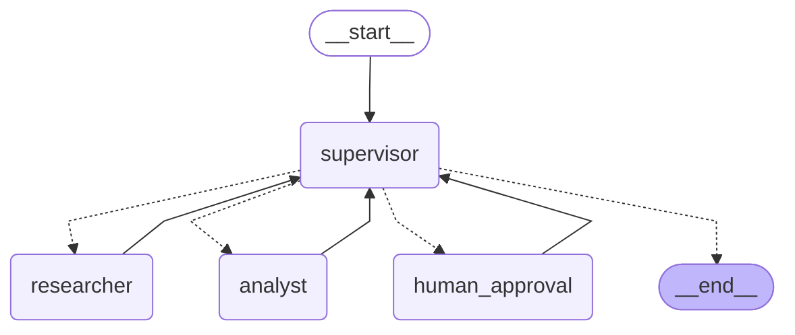

# Intelligence System — Higiene y Seguridad Industrial

Sistema de IA de grado de producción que combina **RAG** (normativa y procedimientos de
higiene y seguridad industrial), un **orquestador multi-agente con Supervisor**
(LangGraph), un gate de **aprobación humana (HITL)** para casos críticos, una **API REST
asíncrona** (FastAPI) y **trazabilidad completa** (LangSmith / Arize Phoenix).

Dado un incidente o una consulta ("un operario sufrió una caída desde un andamio..."), el
sistema busca la normativa/procedimiento aplicable, clasifica la gravedad del caso, genera
recomendaciones concretas y -- si el caso es grave o fatal -- pausa la ejecución hasta que un
responsable de higiene y seguridad confirme el cierre.

## Arquitectura



*(Diagrama generado con `app.get_graph().draw_mermaid()`; también se sirve en caliente desde
la propia API en `GET /graph`, para que nunca quede desincronizado del código real del
grafo. Regenerarlo con `python -c "from app.graph import app; print(app.get_graph().draw_mermaid())"`.)*

```
POST /tasks ──► encola job en Redis (PENDING) ──► asyncio.create_task (worker)
                                                        │
                                                        ▼
                                    supervisor ─┬─► researcher (RAG) ─┐
                                                 │                     │
                                                 ├─► analyst ──────────┤
                                                 │   (gravedad +       │
                                                 │    recomendaciones) │
                                                 │                     │
                                                 └─► human_approval ◄──┘
                                                      (solo si grave/fatal;
                                                       interrupt() pausa el
                                                       grafo, status =
                                                       AWAITING_APPROVAL)
                                                          │
                                     POST /tasks/{id}/approve ──┘
                                     (Command(resume=...): reanuda desde
                                      el checkpoint persistido en Redis)
```

### ¿Por qué topología jerárquica (Supervisor) y no peer-to-peer?

- **Una sola fuente de verdad sobre el flujo**: los especialistas (`researcher`, `analyst`)
  y el gate `human_approval` nunca se comunican entre sí ni deciden "quién sigue". Eso queda
  100% centralizado en `app/agents/supervisor.py::decide_next_agent`, una función **pura**
  (sin LLM), testeada de forma aislada (`tests/test_supervisor_logic.py`).
- **Punto único de validación y de HITL**: como el Supervisor es el único que decide
  `FINISH` o `human_approval`, es también el único lugar donde hace falta aplicar la rúbrica
  de suficiencia y el gate de aprobación para casos críticos. Con topología peer-to-peer esa
  lógica quedaría duplicada o dispersa entre agentes.
- **Escala mejor a más especialistas**: agregar un tercer agente (por ejemplo, un validador
  de cumplimiento normativo) es agregar un nodo más y una rama más en
  `route_from_supervisor`, sin tocar a los especialistas existentes.

## Componentes

### 1. RAG (`app/rag/`, `data/`)

- `data/*.md`: base de conocimiento de higiene y seguridad industrial (marco normativo,
  prevención de riesgos, procedimiento de reporte, primeros auxilios, trabajo en altura,
  riesgo químico y espacios confinados).
- `app/rag/ingest.py`: fragmenta (`chunk_size=500`, `overlap=50`, medidos en tokens) y
  persiste los embeddings en ChromaDB (`./vectorstore`). Idempotente: si la colección ya
  tiene documentos, no reindexa (salvo `--force`).
- `app/rag/rag_settings.py`: única fuente de verdad del modelo de embeddings, usado tanto
  para indexar como para consultar (evita el error #1 de sistemas RAG: indexar con un
  modelo y consultar con otro).
- `app/rag/rag_chain.py`: cadena RAG directa (retriever → prompt "filtro de veracidad" →
  LLM → `PydanticOutputParser` → `RAGResponse`), expuesta en `POST /rag/query` para
  consultas rápidas sin pasar por el orquestador multi-agente completo.
- `app/tools/rag_tools.py`: el mismo vectorstore, pero como **tool** del Agente de
  Investigación dentro del flujo multi-agente.

### 2. Agentes (`app/agents/`, `app/tools/`)

- **`research_agent.py`** — Agente de Investigación. `create_react_agent` + la tool
  `buscar_normativa_seguridad` (retriever real sobre ChromaDB). Nunca interpreta lo que
  encuentra: solo resume y cita fuentes.
- **`analyst_agent.py`** — Agente de Análisis. `create_react_agent` + tres tools de
  `tools/analysis_tools.py`: `clasificar_gravedad` (leve/moderado/grave/fatal),
  `validar_datos_incidente` (validación de esquema mínimo) y `generar_recomendaciones`
  (según la jerarquía de controles). Si clasifica el caso como grave/fatal, marca
  `is_critical=True` en el estado compartido.
- **`supervisor.py`** — Router + rúbrica de suficiencia + salvaguardas anti-bucle + gate
  HITL (ver arriba).

### 3. Human-in-the-loop (`app/hitl.py`)

Si el Agente de Análisis clasifica el caso como **grave** o **fatal**, el Supervisor no
cierra el caso directamente: lo enruta a `human_approval`, que llama a `interrupt(...)` de
LangGraph. Esto pausa el grafo -- el estado queda persistido en Redis vía el checkpointer --
hasta que un responsable de higiene y seguridad llama a `POST /tasks/{id}/approve` con su
decisión. El grafo se reanuda con `Command(resume=...)` exactamente desde donde quedó.

### 4. API (`app/main.py`)

| Endpoint | Método | Descripción |
|---|---|---|
| `/rag/query` | POST | Consulta directa al RAG (sin agentes), rápida. |
| `/tasks` | POST | Encola una tarea en el orquestador multi-agente, devuelve `job_id` sin bloquear. |
| `/tasks/{job_id}` | GET | Estado del job (`PENDING/RUNNING/AWAITING_APPROVAL/DONE/REJECTED/FAILED`). |
| `/tasks/{job_id}/approve` | POST | Resuelve una pausa HITL. |
| `/graph` | GET | Diagrama Mermaid del grafo compilado, generado en caliente. |
| `/health` | GET | Healthcheck. |

Documentación interactiva (Swagger) en `http://localhost:8000/docs`.

### 5. Persistencia y validación

- **Checkpointer de LangGraph**: `AsyncRedisSaver` (Redis Stack) persiste el estado interno
  del grafo -- si el servidor se reinicia mientras un caso está `AWAITING_APPROVAL`, al
  volver a levantar la API el caso sigue pausado exactamente donde quedó.
- **JobStore** (`app/job_store.py`): persistencia del estado del job visto por la API
  (independiente del checkpointer), también en Redis.
- **Pydantic en toda la superficie de E/S**: `app/schemas.py` valida entradas/salidas de la
  API; `RAGResponse` y `SupervisorReview` validan salidas estructuradas de LLM; cada tool de
  `app/tools/` declara su `args_schema` con Pydantic.

### 6. Observabilidad (`app/observability.py`)

Backend configurable con `OBSERVABILITY_BACKEND=langsmith|phoenix|none`. Ambos instrumentan
automáticamente cada nodo del grafo y cada llamada a LLM, por lo que se puede auditar
completamente "lo que ocurre bajo el capó" de cada ejecución (nunca es una caja negra).

## Por qué no se bloquea el event loop (todo async)

- Los endpoints solo escriben en Redis (`redis.asyncio`) y lanzan `asyncio.create_task(...)`
  -- no esperan a que el agente termine.
- Los tres nodos del grafo que llaman a LLM (`supervisor`, `researcher`, `analyst`) son
  `async def` y usan `await ...ainvoke(...)`, nunca `.invoke()` síncrono.
- El retriever del RAG se consulta con `await retriever.ainvoke(...)`.
- El checkpointer usa `AsyncRedisSaver` (`aget`/`aput` async).
- `human_approval_node` es sync porque solo llama a la primitiva de control
  `interrupt()` de LangGraph (no hace I/O ni llamadas a LLM/DB).

## Instalación

### Opción A: Docker Compose (recomendada, un solo comando)

```bash
cp .env.example .env
# Completar GOOGLE_API_KEY (embeddings, obligatorio) y, si se usa,
# LANGSMITH_API_KEY / OBSERVABILITY_BACKEND=phoenix.

./run.sh
# valida el .env y ejecuta: docker compose up --build
```

Si falta una variable obligatoria, `run.sh` termina con un mensaje que indica cuál antes de
levantar Docker. La API repite la validación al arrancar (`app/env_check.py`), así que también
cubre a quien la levanta directo con `docker compose` o `uvicorn`.

Esto levanta Redis Stack + la API en `http://localhost:8000`. Para Arize Phoenix
self-hosted en vez de LangSmith:

```bash
docker compose --profile phoenix up -d phoenix
# y en .env: OBSERVABILITY_BACKEND=phoenix
```

### Opción B: entorno local (Python 3.12)

```bash
python -m venv .venv
.venv\Scripts\Activate.ps1        # Windows
# source .venv/bin/activate       # Linux/Mac

pip install -r requirements-dev.txt
cp .env.example .env
# completar .env

docker compose up -d redis        # Redis Stack sigue haciendo falta

uvicorn app.main:app --reload --port 8000
```

## Uso

### Consulta directa al RAG

```bash
curl -X POST http://localhost:8000/rag/query -H "Content-Type: application/json" \
  -d "{\"question\": \"¿Qué elementos de protección personal se usan ante riesgo de caída de altura?\"}"
```

### Caso normal (sin HITL)

```bash
curl -X POST http://localhost:8000/tasks -H "Content-Type: application/json" \
  -d "{\"input\": \"Un operario sufrió un corte leve en la mano al manipular una chapa.\"}"
# -> {"job_id": "...", "status": "PENDING"}

curl http://localhost:8000/tasks/<job_id>
# -> {"status": "DONE", "result": {...}}
```

### Caso crítico (dispara HITL)

```bash
curl -X POST http://localhost:8000/tasks -H "Content-Type: application/json" \
  -d "{\"input\": \"Un trabajador falleció tras caer desde un andamio de 4 metros en obra.\"}"

curl http://localhost:8000/tasks/<job_id>
# -> {"status": "AWAITING_APPROVAL", "awaiting_approval": {"message": "...", "reason": "...", ...}}

curl -X POST http://localhost:8000/tasks/<job_id>/approve -H "Content-Type: application/json" \
  -d "{\"approved\": true, \"comment\": \"confirmado por responsable de HyS\"}"

curl http://localhost:8000/tasks/<job_id>
# -> {"status": "DONE", "result": {...}}
```

### CLI local (sin Redis)

```bash
python cli.py "Un operario sufrió una fractura expuesta al caer de un andamio."
```

## Tests

Suite completa, sin API keys ni `.env` y con un Redis propio y descartable:

```bash
docker compose -f docker-compose.test.yml run --rm --build tests
```

Con un entorno local, `pytest -v` corre los tests unitarios y omite los que necesitan Redis.
Para incluirlos, `TEST_REDIS_URL=redis://localhost:6379/0 pytest -v`.

**End-to-end** (`tests/e2e/test_api_hitl_flow.py`): levanta uvicorn en otro proceso contra Redis
Stack real y recorre por HTTP el caso normal, el crítico aprobado y el crítico rechazado. También
mata el proceso con SIGKILL mientras un caso está `AWAITING_APPROVAL`, lo vuelve a levantar y
verifica que el caso se aprueba y termina sin repetir a los especialistas. Comprueba además que
la API no arranca sin `GOOGLE_API_KEY`.

**Integración** (`tests/integration/test_checkpoint_recovery.py`): `AsyncRedisSaver` y `JobStore`
reales. Cierra y vuelve a crear checkpointer, grafo y JobStore, y verifica que el estado se
recupera solo desde Redis, con la decisión de aprobar o rechazar y con varios casos pausados a la vez.

En estos dos grupos el LLM y la ingesta del RAG están reemplazados por respuestas fijas
(`tests/support/`) para que sean determinísticos y no gasten cuota: el resto (nodos, enrutamiento,
`interrupt`, checkpointer, JobStore y API) es el código real. La calidad de las respuestas del
modelo y la recuperación del RAG no se evalúan acá.

**Unitarios** (sin API key ni Redis):

- `test_env_check.py`: validación de entorno al arrancar, en la API y en `run.sh`.
- `test_langsmith_metrics.py`: cálculo de percentiles y agrupación de trazas por ejecución.
- `test_supervisor_logic.py`: rúbrica de suficiencia, garantía de terminación y el gate HITL
  (incluye simulación adversarial donde el LLM "insiste" en refinar indefinidamente).
- `test_tools.py`: tools de análisis (clasificación de gravedad, validación, recomendaciones).
- `test_rag.py`: formateo de citas y validación del esquema `RAGResponse`.
- `test_api_schemas.py`: validación Pydantic de los esquemas de la API.
- `test_graph_structure.py`: el grafo se construye con los nodos esperados y genera un
  diagrama Mermaid válido.

## Calidad de código

Se configuran en `pyproject.toml` y corren con las versiones fijadas:

```bash
docker compose -f docker-compose.test.yml run --rm --build tests sh -c "ruff check . && ruff format --check . && mypy"
```

## Dependencias

- `pyproject.toml`: dependencias directas con versión exacta.
- `requirements.txt` y `requirements-dev.txt`: lock completo, incluidas las transitivas, para
  Linux y Python 3.12, que es el entorno de la imagen Docker. En Windows o Mac, `pip` puede sumar
  paquetes propios de esa plataforma que no están en el lock; el entorno reproducible es Docker.
- `Dockerfile` y los `docker-compose*.yml`: imágenes base con versión exacta, sin `latest`.

Para actualizar una dependencia, cambiar su versión en `pyproject.toml` y regenerar los locks con
Python 3.12 en Linux:

```bash
pip-compile --no-header --no-annotate --no-emit-options --strip-extras -o requirements.txt pyproject.toml
pip-compile --no-header --no-annotate --no-emit-options --strip-extras --extra dev -o requirements-dev.txt pyproject.toml
```

## Prueba de carga y observabilidad (mínimo 5 ejecuciones)

Con la API, Redis y el backend de observabilidad levantados:

```bash
python scripts/load_test.py
```

Dispara 6 tareas (dos críticas, auto-aprobadas por el script) y hace polling hasta que
terminan. Con esas trazas generadas, entrar al dashboard (LangSmith o Phoenix) y revisar
cómo se distribuye la latencia entre nodos, qué nodo consume más tokens y el costo por
ejecución; guardar capturas en [`screenshots/`](screenshots/) según
[`screenshots/README.md`](screenshots/README.md).

### Latencia y costo medidos

Leídos de las trazas de LangSmith con `python scripts/langsmith_metrics.py --days 30`, el
30/10/2026. Son las 12 ejecuciones del orquestador corridas el 22/10/2026 con `gemini-3.5-flash-lite`:

| Resultado | Ejecuciones | Latencia p50 | Latencia p95 | Tokens promedio | Costo promedio | Costo p95 |
|---|---:|---:|---:|---:|---:|---:|
| Exitosa | 6 | 7.33 s | 42.54 s | 6,269 | $0.0035 | $0.0042 |
| Con error | 6 | 40.19 s | 44.43 s | 4,047 | $0.0025 | $0.0035 |

Cómo leer estos números:

- **La muestra es chica.** Con 6 ejecuciones, el p95 coincide con el valor máximo, así que sirve
  como referencia y no como un objetivo de servicio. Cinco de las seis exitosas tardaron menos de
  10 s; la restante, 42.54 s.
- **Las 6 fallidas son del mismo motivo.** Son la primera tanda concurrente, que terminó con `429
  RESOURCE_EXHAUSTED` de Gemini, el límite de cuota del proveedor. Por eso se informan aparte.
- **Una ejecución es un caso completo.** Si tuvo HITL, se suman sus dos trazas (hasta la pausa y
  desde la reanudación), y la latencia no incluye el tiempo de espera de la decisión humana.
- **El costo es la estimación de LangSmith** según tokens y modelo, no un importe facturado.

## Manejo de errores

Si el agente falla en cualquier nodo (excepción de LLM, timeout, etc.), `app/worker.py`
captura la excepción y actualiza el job a `FAILED` con el mensaje de error -- el cliente que
hace polling en `GET /tasks/{id}` ve `FAILED` en vez de quedarse esperando indefinidamente.

## Estructura del repositorio

```
EntregaFINAL/
├── app/
│   ├── main.py               # FastAPI: /rag/query, /tasks, /tasks/{id}, /graph, /health
│   ├── graph.py                # StateGraph: supervisor + especialistas + HITL
│   ├── state.py                  # OrchestratorState (esquema del estado compartido)
│   ├── settings.py                 # Configuración vía variables de entorno (pydantic-settings)
│   ├── env_check.py                # Validación del entorno al arrancar
│   ├── schemas.py                    # Modelos Pydantic de la API
│   ├── llm_provider.py                 # Selección de proveedor de LLM + rotación de keys
│   ├── rotating_llm.py                   # ChatGoogleGenerativeAI con rotación de API keys
│   ├── observability.py                    # Init de LangSmith / Arize Phoenix
│   ├── job_store.py                          # Persistencia del estado del job en Redis
│   ├── worker.py                               # Corre el grafo en background
│   ├── hitl.py                                   # Nodo de aprobación humana + endpoint
│   ├── agents/
│   │   ├── supervisor.py                           # Router + rúbrica + salvaguardas + HITL gate
│   │   ├── research_agent.py                         # Agente de Investigación (RAG)
│   │   ├── analyst_agent.py                            # Agente de Análisis (gravedad + recomendaciones)
│   │   └── utils.py
│   ├── tools/
│   │   ├── rag_tools.py                                  # buscar_normativa_seguridad (retriever real)
│   │   └── analysis_tools.py                               # clasificar_gravedad, validar_datos_incidente, generar_recomendaciones
│   └── rag/
│       ├── rag_settings.py                                   # Config de embeddings/LLM del RAG
│       ├── ingest.py                                           # Ingesta a ChromaDB
│       ├── rag_chain.py                                          # Cadena RAG directa (POST /rag/query)
│       └── formatting.py                                           # Formateo compartido de citas
├── data/                      # Base de conocimiento (marco normativo, EPP, trabajo en
│                                 altura, riesgo químico, primeros auxilios, reporte)
├── tests/                     # Unitarios, integración y E2E (ninguno usa LLM ni API keys)
├── scripts/load_test.py       # 6 ejecuciones concurrentes para poblar el dashboard
├── scripts/langsmith_metrics.py # Latencia p50/p95 y costo por ejecución desde LangSmith
├── screenshots/                # Capturas del dashboard de observabilidad
├── cli.py                       # Demo local sin Redis/API
├── docker-compose.yml              # Redis Stack + API (+ Phoenix opcional)
├── docker-compose.test.yml         # Suite completa con un Redis descartable
├── Dockerfile
├── run.sh                             # Valida el .env y levanta todo con un solo comando
├── pyproject.toml                     # Dependencias directas + pytest, ruff y mypy
├── requirements.txt                   # Lock de producción
├── requirements-dev.txt               # Lock de desarrollo y tests
├── .env.example
└── .gitignore
```

## Errores comunes evitados (checklist)

- ✅ **Hard-coding**: modelos, índices/colecciones, límites del Supervisor y backend de
  observabilidad se configuran vía variables de entorno (`app/settings.py`,
  `app/rag/rag_settings.py`), nunca hardcodeados.
- ✅ **Sincronicidad**: ninguna llamada a LLM/DB usa E/S bloqueante dentro de una función
  `async def`; todos los nodos con LLM son `async def` + `ainvoke`, el checkpointer es
  `AsyncRedisSaver`, el retriever se consulta con `ainvoke`.
- ✅ **Falta de trazas**: observabilidad activa (LangSmith o Phoenix) instrumentando cada
  nodo del grafo -- ver checklist de `/screenshots`.
- ✅ **Supervisor Infinito**: `decide_next_agent` es una función pura, testeada de forma
  aislada, con `MAX_STEPS`, `MAX_REFINEMENTS` y el gate HITL (que se resuelve una única vez)
  como topes duros.
- ✅ **Contaminación de contexto**: cada especialista recibe solo la instrucción/dato que
  necesita, nunca el historial completo de `messages`.
- ✅ **Validación antes del cierre**: el Supervisor no cierra un caso solo porque el
  Analista respondió algo -- chequea la rúbrica (gravedad + recomendación explícitas) y, si
  es crítico, exige aprobación humana antes del `FINISH`.

## Procedencia

Este repositorio integra y refactoriza las pre-entregas de arquitectura multi-agente con
Supervisor (Módulo 6) y de API de producción con checkpointer/HITL/observabilidad (Módulo
7), reemplazando su caso de uso genérico de demo por un dominio real -- higiene y seguridad
industrial -- y reutilizando/adaptando el sistema RAG construido en un módulo anterior sobre
accidentes laborales como motor de recuperación del Agente de Investigación.
